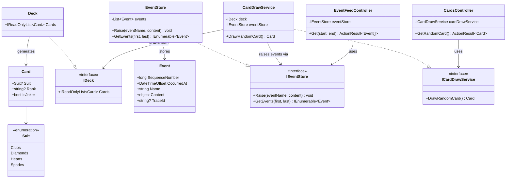
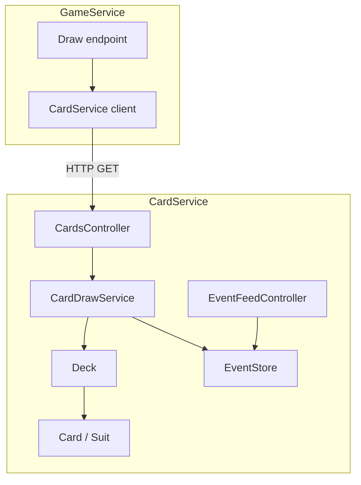

# diplom-storesys-card-drawer

A small two-microservice system for drawing playing cards. Built for the "Udvikling af store systemer" module on the Diplomuddannelse i softwareudvikling, based on the microservice patterns from *Microservices in .NET* (2nd ed.) by Christian Horsdal Gammelgaard.

- **CardService** draws a random card from a full deck (52 cards + 3 jokers, equal probability) and returns it as JSON.
- **GameService** receives a draw request, calls CardService over HTTP, and returns the drawn card.

## Assignment

The system exposes HTTP endpoints that return a randomly drawn card as JSON, with equal probability for every card in the deck. CardService owns the deck and the draw; GameService is the client-facing service that calls CardService.

## Architecture

The services follow the flat project structure used in chapter 2 of the book (see the [`book-reference/flat-structure`](https://github.com/anit3k/diplom-storesys-shopping-cart/tree/book-reference/flat-structure) branch of [diplom-storesys-shopping-cart](https://github.com/anit3k/diplom-storesys-shopping-cart) for the reference implementation), rather than a layered Clean Architecture split.

- **CardService**: generates the full 55-card deck locally in code (`IDeck` / `Deck`) — no external dependency — then draws one card uniformly at random via `CardDrawService` / `ICardDrawService`, and returns it through its HTTP endpoint (`CardsController`, `GET /cards/random`). See [ADR 0001](docs/adr/0001-generate-deck-locally.md) for why the deck is local.
- **GameService**: an ASP.NET Core Web API that will call CardService through a typed `HttpClient` and expose its own draw endpoint. (Endpoint and typed client are added in the next steps.)
- **Event store** (CardService): an in-memory `IEventStore` / `EventStore`, following the book's chapter 2 event feed pattern — every card draw raises a `CardDrawn` event, exposed to other microservices via a `GET /events` endpoint on `EventFeedController`.

```
src/
├── CardService/
│   ├── Card.cs                  domain model (Suit, Rank, IsJoker)
│   ├── IDeck.cs                  interface for the full deck
│   ├── Deck.cs                   locally generated 55-card deck
│   ├── ICardDrawService.cs       interface for drawing a card
│   ├── CardDrawService.cs        draws a uniformly random card, raises a CardDrawn event
│   ├── CardsController.cs        HTTP endpoint (GET /cards/random)
│   ├── Event.cs                  event feed model (SequenceNumber, OccurredAt, Name, Content, TraceId)
│   ├── IEventStore.cs            interface for raising/reading events
│   ├── EventStore.cs             in-memory event store implementation
│   ├── EventFeedController.cs    HTTP endpoint (GET /events)
│   ├── Program.cs
│   ├── appsettings.json
│   └── CardService.csproj
└── GameService/
    ├── Card.cs                   card DTO for deserializing CardService's response
    ├── CardServiceOptions.cs     options bound from CardService:BaseUrl
    ├── ICardServiceClient.cs     interface for the CardService client
    ├── CardServiceClient.cs      typed HttpClient that calls CardService
    ├── DrawController.cs         HTTP endpoint (GET /draw)
    ├── Program.cs
    ├── appsettings.json
    └── GameService.csproj
```

## Running locally

The system runs as two services on fixed HTTP ports (no HTTPS locally):

| Service     | URL                   |
|-------------|-----------------------|
| CardService | http://localhost:5054 |
| GameService | http://localhost:5064 |

GameService reads CardService's base URL from its `appsettings.json` (`CardService:BaseUrl`), so start CardService first.

Open **two** PowerShell terminals.

Terminal 1 — CardService:

```powershell
dotnet run --project src\CardService
```

Terminal 2 — GameService:

```powershell
dotnet run --project src\GameService
```

Draw a card through GameService — the happy path, where GameService calls CardService and returns the card:

```powershell
Invoke-RestMethod http://localhost:5064/draw
```

Example response (ordinary card):

```json
{ "suit": "Hearts", "rank": "Queen", "isJoker": false }
```

Example response (joker — a joker has no suit and no rank):

```json
{ "suit": null, "rank": null, "isJoker": true }
```

You can also call CardService directly:

```powershell
Invoke-RestMethod http://localhost:5054/cards/random
```

And check the event feed for the CardDrawn events this generated:

```powershell
Invoke-RestMethod "http://localhost:5054/events?start=0&end=100"
```

A Postman collection (`CardService.postman_collection.json`) is included for manual testing. It has `cardServiceUrl` and `gameServiceUrl` variables preset to the ports above.

## Resilience

GameService's call to CardService is guarded by an explicit resilience pipeline (via `Microsoft.Extensions.Http.Resilience`, Polly v8), configured under `CardService:Resilience` in GameService's `appsettings.json` and validated at startup:

| Setting            | Default | Meaning                                                           |
|--------------------|---------|-------------------------------------------------------------------|
| `AttemptTimeout`   | 500 ms  | per individual attempt (one HTTP request)                         |
| `TotalTimeout`     | 3 s     | whole operation (all attempts + back-off waits)                   |
| `MaxRetryAttempts` | 2       | retries after the first attempt (3 attempts total)               |
| `RetryBaseDelay`   | 200 ms  | base for exponential back-off (~200 ms, ~400 ms)                 |
| `UseJitter`        | true    | jitter the back-off in production; tests turn it off             |
| `FailureRatio`     | 0.5     | failure fraction (over the window) that opens the breaker        |
| `MinimumThroughput`| 6       | min calls in the window before the ratio is judged               |
| `SamplingDuration` | 30 s    | window the failure ratio is measured over                        |
| `BreakDuration`    | 10 s    | how long the breaker stays open before a half-open trial         |

Pipeline order: total timeout → **retry** → **circuit breaker** → attempt timeout.

**Retry** fires only on transient failures — the per-attempt timeout, network errors, and HTTP 408/429/502/503/504 — with exponential back-off + jitter. It does **not** retry 500, other 4xx, caller cancellation, the total timeout, or a call rejected by an open breaker.

**Circuit breaker** sits inside retry (so every attempt counts). It counts as failures the per-attempt timeout, network errors, **all 5xx including 500**, and 408/429 — but **not** other 4xx. The failure list deliberately differs from retry's: retry asks "will another attempt help?", the breaker asks "is the service healthy?". When open it fails fast (no downstream call, no retry) for `BreakDuration`, then allows one half-open trial. Because one fully failed request = 3 attempts, the breaker opens after ~2 fully failed requests (or ~6 requests for non-retried 500s).

Values can be overridden for tests, e.g. `CardService__Resilience__RetryBaseDelay` / `__UseJitter` / `__BreakDuration` (timeouts must be ≥ 10 ms; breaker durations ≥ 500 ms — Polly floors). See [ADR 0003](docs/adr/0003-card-service-timeouts.md) (timeouts), [ADR 0004](docs/adr/0004-retry-on-transient-failures.md) (retry) and [ADR 0006](docs/adr/0006-circuit-breaker.md) (circuit breaker); library choice in [ADR 0002](docs/adr/0002-resilience-library-choice.md).

### Idempotency

Because a retry could otherwise draw a second card and raise a second `CardDrawn` event, GameService sends one `Idempotency-Key` (a GUID) per draw — the same key across all retries of that draw. CardService caches key → card (default 5 min, `Idempotency:CacheDuration`): a repeated key returns the same card, raises no new event, and sets `Idempotency-Replayed: true`. No key = unchanged behaviour; an empty or over-128-character key returns `400`. See [ADR 0005](docs/adr/0005-idempotency-key-for-draw.md).

### Error responses

When a draw fails, GameService returns `{ "error", "message", "traceId" }` (`application/json`; `message` is a short Danish text, no internal detail — that is logged server-side only):

| Situation | Status | `error` |
|---|---|---|
| Timeout | 504 | `card_service_timeout` |
| CardService unavailable (unreachable, or 503 after retries) | 503 | `card_service_unavailable` |
| Circuit breaker open | 503 | `card_service_circuit_open` |
| CardService 500 / non-503 5xx / 4xx / invalid body | 502 | `card_service_bad_response` |
| Unexpected error in GameService | 500 | `internal_error` |

The typed client translates resilience-library failures into its own `CardServiceException`, and a central `IExceptionHandler` maps everything to the table above — the controller stays thin. A CardService 500 becomes 502 (the fault is a dependency's, not GameService's). See [ADR 0007](docs/adr/0007-error-responses.md).

## Health endpoints

Both services expose a **liveness** endpoint, `GET /health/live`, that returns `200 OK` with body `Healthy` when the process is up. It checks **no** dependencies — in particular GameService's liveness does **not** call CardService — so a downstream outage never makes a healthy process look unhealthy (which would cause an orchestrator to restart it). See [ADR 0008](docs/adr/0008-liveness-health-endpoint.md).

```powershell
Invoke-WebRequest http://localhost:5054/health/live   # CardService -> 200, "Healthy"
```

```powershell
Invoke-WebRequest http://localhost:5064/health/live   # GameService -> 200, "Healthy"
```

GameService stays live even when CardService is down:

```powershell
Invoke-WebRequest http://localhost:5064/health/live   # still 200 "Healthy" with CardService stopped
```

**Scope:** liveness only. There is intentionally no `/health/ready` or `/health/startup` (no readiness/dependency probe) at this stage.

## Logging

Both services log **structured JSON** to the console via Serilog — one line per event with `Timestamp`, `Level`, `RenderedMessage`, and `TraceId`/`SpanId`. Each request is summarised in a single line (method, path, status, elapsed ms); `/health/live` logs at Debug to stay quiet.

Levels: minimum **Debug** in Development (`appsettings.Development.json`), **Information** otherwise (`appsettings.json`); noisy framework categories are turned down to Warning. Retries, timeouts and circuit-breaker transitions log at Warning; unexpected errors at Error; startup failures at Fatal. Sensitive data, request bodies/headers and the user-facing error message are never logged.

**Trace id:** the call is correlated with the standard W3C `traceparent` header (handled by ASP.NET and `HttpClient`), so one `TraceId` follows a `/draw` through both services, into CardService's `CardDrawn` event (its `traceId` field), and into the error response's `traceId` — no custom correlation header. See [ADR 0009](docs/adr/0009-structured-logging.md) (logging) and [ADR 0010](docs/adr/0010-trace-context.md) (trace context).

### Example: one trace across both services

A `/draw` called with `traceparent: 00-aaaabbbbccccddddeeeeffff00001111-...-01`. Two log lines from the same run — GameService's outgoing call and CardService's summary of the incoming call — share the same `TraceId` (lines shortened: framework fields like `EventId`, `RequestId`, `ConnectionId`, `Scope` removed):

```json
// GameService — outgoing call to CardService
{"Timestamp":"2026-11-10T17:44:51.6443293+01:00","Level":"Information","RenderedMessage":"Sending HTTP request \"GET\" \"http://localhost:5054/cards/random\"","TraceId":"aaaabbbbccccddddeeeeffff00001111","SpanId":"e4bd7498f70b9600","Properties":{"SourceContext":"System.Net.Http.HttpClient.ICardServiceClient.ClientHandler"}}
```

```json
// CardService — summary of the incoming request
{"Timestamp":"2026-11-10T17:44:51.7157844+01:00","Level":"Information","RenderedMessage":"HTTP \"GET\" \"/cards/random\" responded 200 in 26.1170 ms","TraceId":"aaaabbbbccccddddeeeeffff00001111","SpanId":"72c5c8c0895c6040","Properties":{"SourceContext":"Serilog.AspNetCore.RequestLoggingMiddleware","StatusCode":200,"Elapsed":26.117}}
```

The same `traceId` is also on the `CardDrawn` event in `GET /events`. To follow one trace across both services, filter each service's log on the trace id. For example, if each service's console output is redirected to a file:

```powershell
dotnet run --project src\CardService  > card.log 2>&1   # terminal 1
dotnet run --project src\GameService  > game.log 2>&1   # terminal 2
Select-String -Path card.log,game.log -Pattern '<trace-id>'
```

## Running the tests

Run the whole suite from the repository root (PowerShell 7):

```powershell
dotnet test
```

Tests live under `tests/`:

- **`CardService.UnitTests`** — in-process tests for CardService using xUnit and `Microsoft.AspNetCore.Mvc.Testing` (`WebApplicationFactory<Program>`), with hand-made fakes (no mocking/assertion libraries). They cover the deck, the draw's uniform index selection, the `GET /cards/random` shape (ordinary card and joker), idempotency, concurrency, the trace id on the `CardDrawn` event, and `GET /health/live`. Randomness is injected so the tests are deterministic, and each test boots its own host, so runs are repeatable. See [ADR 0011](docs/adr/0011-test-strategy.md).

GameService's service-level tests are added in a later step.

## Tech stack

- .NET 10
- ASP.NET Core MVC (controllers, not minimal APIs — to match the book's approach)
- JetBrains Rider

## AI-assisted development

Parts of this project (planning, code review, and boilerplate scaffolding) were developed with assistance from Claude (Anthropic). AI was used as a pair-programming aid — for discussing architectural trade-offs, reviewing code the author wrote, and generating small, well-understood boilerplate (e.g. Postman collection) — not for producing the final domain logic unreviewed. All code was written and understood by the author as part of the learning objective for this module.

## Class diagram (CardService)



## Package diagram



## Related repositories

- [diplom-storesys-shopping-cart](https://github.com/anit3k/diplom-storesys-shopping-cart) — the ShoppingCart/ProductCatalog reference implementation this project's flat structure is modeled after.
