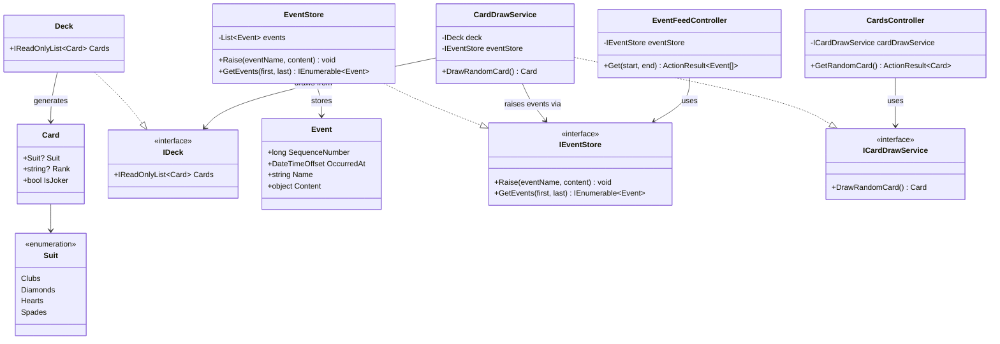
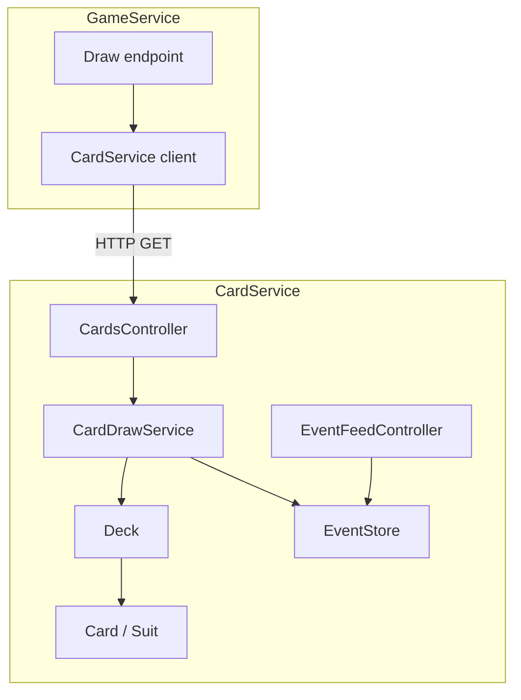

# diplom-storesys-card-drawer

A small two-microservice system for drawing playing cards. Built for the "Udvikling af store systemer" module on the Diplomuddannelse i softwareudvikling, based on the microservice patterns from *Microservices in .NET* (2nd ed.) by Christian Horsdal Gammelgaard.

- **CardService** draws a random card from a full deck (52 cards + 3 jokers, equal probability) and returns it as JSON.
- **GameService** receives a draw request, calls CardService over HTTP, and returns the drawn card.

## Assignment

The system exposes HTTP endpoints that return a randomly drawn card as JSON, with equal probability for every card in the deck. CardService owns the deck and the draw; GameService is the client-facing service that calls CardService.

## Architecture

The services follow the flat project structure used in chapter 2 of the book (see the [`book-reference/flat-structure`](https://github.com/anit3k/diplom-storesys-shopping-cart/tree/book-reference/flat-structure) branch of [diplom-storesys-shopping-cart](https://github.com/anit3k/diplom-storesys-shopping-cart) for the reference implementation), rather than a layered Clean Architecture split.

- **CardService**: generates the full 55-card deck locally in code (`IDeck` / `Deck`) — no external dependency — then draws one card uniformly at random via `CardDrawService` / `ICardDrawService`, and returns it through its HTTP endpoint (`CardsController`, `GET /cards/random`). See [ADR 0001](docs/adr/0001-generate-deck-locally.md) for why the deck is local.
- **GameService**: an ASP.NET Core Web API that will call CardService through a typed `HttpClient` and expose its own draw endpoint. (Endpoint and typed client are added in the next steps.)
- **Event store** (CardService): an in-memory `IEventStore` / `EventStore`, following the book's chapter 2 event feed pattern — every card draw raises a `CardDrawn` event, exposed to other microservices via a `GET /events` endpoint on `EventFeedController`.

```
src/
├── CardService/
│   ├── Card.cs                  domain model (Suit, Rank, IsJoker)
│   ├── IDeck.cs                  interface for the full deck
│   ├── Deck.cs                   locally generated 55-card deck
│   ├── ICardDrawService.cs       interface for drawing a card
│   ├── CardDrawService.cs        draws a uniformly random card, raises a CardDrawn event
│   ├── CardsController.cs        HTTP endpoint (GET /cards/random)
│   ├── Event.cs                  event feed model (SequenceNumber, OccurredAt, Name, Content)
│   ├── IEventStore.cs            interface for raising/reading events
│   ├── EventStore.cs             in-memory event store implementation
│   ├── EventFeedController.cs    HTTP endpoint (GET /events)
│   ├── Program.cs
│   ├── appsettings.json
│   └── CardService.csproj
└── GameService/
    ├── Card.cs                   card DTO for deserializing CardService's response
    ├── CardServiceOptions.cs     options bound from CardService:BaseUrl
    ├── ICardServiceClient.cs     interface for the CardService client
    ├── CardServiceClient.cs      typed HttpClient that calls CardService
    ├── DrawController.cs         HTTP endpoint (GET /draw)
    ├── Program.cs
    ├── appsettings.json
    └── GameService.csproj
```

## Running locally

The system runs as two services on fixed HTTP ports (no HTTPS locally):

| Service     | URL                   |
|-------------|-----------------------|
| CardService | http://localhost:5054 |
| GameService | http://localhost:5064 |

GameService reads CardService's base URL from its `appsettings.json` (`CardService:BaseUrl`), so start CardService first.

Open **two** PowerShell terminals.

Terminal 1 — CardService:

```powershell
dotnet run --project src\CardService
```

Terminal 2 — GameService:

```powershell
dotnet run --project src\GameService
```

Draw a card through GameService — the happy path, where GameService calls CardService and returns the card:

```powershell
Invoke-RestMethod http://localhost:5064/draw
```

Example response (ordinary card):

```json
{ "suit": "Hearts", "rank": "Queen", "isJoker": false }
```

Example response (joker — a joker has no suit and no rank):

```json
{ "suit": null, "rank": null, "isJoker": true }
```

You can also call CardService directly:

```powershell
Invoke-RestMethod http://localhost:5054/cards/random
```

And check the event feed for the CardDrawn events this generated:

```powershell
Invoke-RestMethod "http://localhost:5054/events?start=0&end=100"
```

A Postman collection (`CardService.postman_collection.json`) is included for manual testing. It has `cardServiceUrl` and `gameServiceUrl` variables preset to the ports above.

## Tech stack

- .NET 10
- ASP.NET Core MVC (controllers, not minimal APIs — to match the book's approach)
- JetBrains Rider

## AI-assisted development

Parts of this project (planning, code review, and boilerplate scaffolding) were developed with assistance from Claude (Anthropic). AI was used as a pair-programming aid — for discussing architectural trade-offs, reviewing code the author wrote, and generating small, well-understood boilerplate (e.g. Postman collection) — not for producing the final domain logic unreviewed. All code was written and understood by the author as part of the learning objective for this module.

## Class diagram (CardService)



## Package diagram



## Related repositories

- [diplom-storesys-shopping-cart](https://github.com/anit3k/diplom-storesys-shopping-cart) — the ShoppingCart/ProductCatalog reference implementation this project's flat structure is modeled after.
