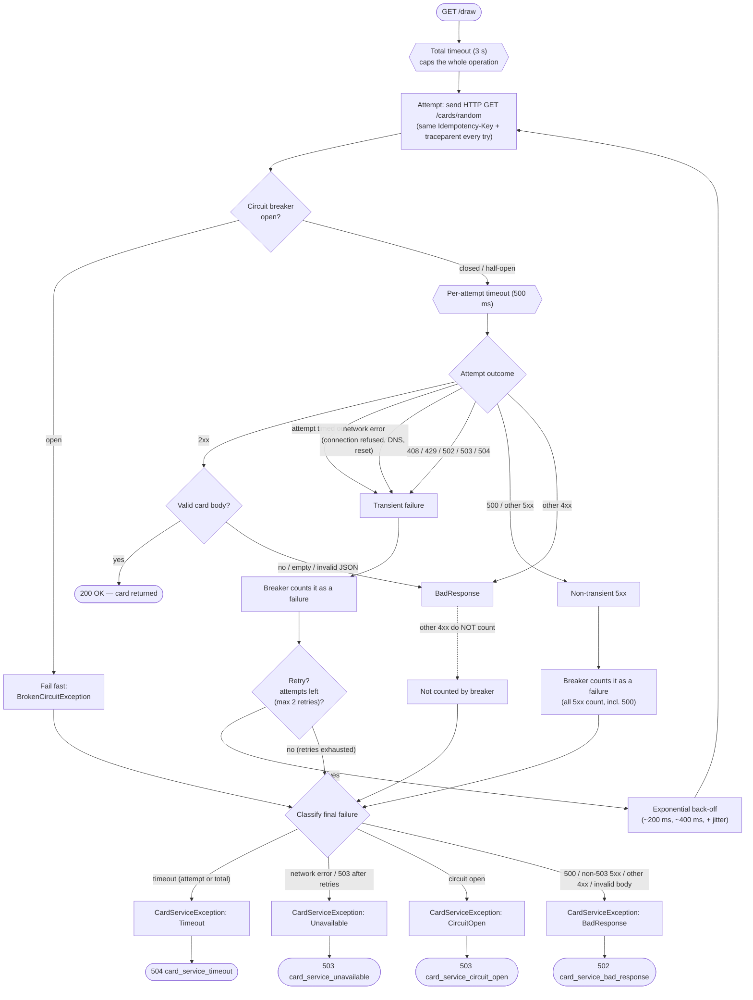

# Resilience flow (GameService → CardService)

How one `GET /draw` travels through GameService's resilience pipeline on its way to
CardService, and how each kind of failure is turned into an HTTP error response.

The pipeline is built outer-to-inner in `Program.cs` as **total timeout → retry →
circuit breaker → per-attempt timeout**, so a single attempt is bounded by the attempt
timeout, retries re-run the attempt, the breaker counts every attempt, and the total
timeout caps the whole operation. The typed `CardServiceClient` translates the
library's failures into a `CardServiceException`, which the central exception handler
maps to the `{ error, message, traceId }` response (see
[ADR 0003](../adr/0003-card-service-timeouts.md)–[0007](../adr/0007-error-responses.md)).

## Pipeline flow

## Notes

- **Retry** fires only on transient failures — per-attempt timeout, network errors, and
  HTTP 408/429/502/503/504 — with exponential back-off + jitter. It does **not** retry
  500, other 4xx, caller cancellation, or the total timeout.
- **Circuit breaker** sits inside retry (so every attempt counts) and its failure list is
  deliberately different from retry's: it counts the per-attempt timeout, network errors,
  **all 5xx (including 500)**, and 408/429 — but not other 4xx. Retry asks "will another
  attempt help?"; the breaker asks "is the service healthy?".
- Because one fully failed request = 3 attempts, the breaker opens after ~2 fully failed
  requests (or ~6 requests for non-retried 500s), then fails fast for `BreakDuration`
  before allowing one half-open trial.
- A CardService **500** becomes **502** on the way out — the fault is a dependency's, not
  GameService's.
